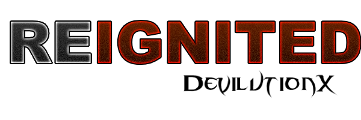

---

# What is Reignited

Reignited is a mod based on the [devilutionX project](https://github.com/diasurgical/DevilutionX).
It's made primarily to balance and refresh gameplay by modifying or adding mechanics, but without too big an impact on the original gameplay.
Reignited is made purely for the base version of the game. It probably works with Hellfire, but it wasn't tested for it and bugs can happen.
It's available only for Windows 64-bit. To play on other platforms, it's possible to download the source and compile it following the devilutionX guides. For this, the Reignited branch should be picked.

# What's different in Reignited?

- new character stats like critical chance, spell damage, block chance, or physical resist.
- each character has a higher cap on base stats, but with limits on how many elixirs can be consumed.
- added penalty for using potions too often. A potion used within 5 seconds has 25% reduced effectiveness. The effect stacks.
- potion flasks also stack :)
- to enter higher difficulties it is now mandatory to finish lower difficulty.
- added resistance penalties on higher difficulties.
- monsters also get critical chance and physical resist.
- replaced character skills with combat-oriented ones.
- rebalance of magic. Damage formula for spells changed, making magic and spell level the main stats to calculate spell damage, duration, etc.
- rebalance of weapons. Damage formula for all weapon types was changed. Base stats increase weapon damage by a percent, instead of adding only a flat bonus.
- new item tiers. Similar to how D2 did it, new tiers of items can be found on higher difficulties. Overall stats of items were adjusted to this. Also added new armors for mages.
- new item affixes for new stats. Some existing ones were adjusted to the new stats.
- added Rare items. Rare items have 3 affixes, always at least 1 prefix and 1 suffix. The 3rd affix is random. Chance to drop a rare item is very low.
- Griswold learned to reforge items. It allows magic items to get an additional affix and upgrade a magic item to a rare item, for a price.
- removed any permanent stat-decrease effects in the game. Black Death or shrines can't reduce stats. It's not fun to get HP reduced only because a warrior got hit by a zombie.
- The Dark Lord got buffed and gained new spells in his arsenal. He also rewards the player with items (some can drop only in that fight) that can be picked up within 60 seconds after defeating him.

# How to Install

Note: You'll need access to the data from the original game. If you don't have an original CD then you can [buy Diablo from GoG.com](https://www.gog.com/game/diablo).

Download the latest [DevilutionX release](https://github.com/Hato-games/DevilutionX-Reignited/releases/latest) and extract the contents to a location of your choosing or [build from source](#building-from-source).

- Copy `DIABDAT.MPQ` from the CD or GOG-installation (or [extract it from the GoG installer](https://github.com/diasurgical/devilutionX/wiki/Extracting-the-.MPQs-from-the-GoG-installer)) to the Reignited folder.

For more detailed instructions: [Installation Instructions](./docs/installing.md).

# Legal

Reignited is made publicly available and released under the Sustainable Use License (see [LICENSE](LICENSE.md))

The source code in this repository is for non-commercial use only. If you use the source code you may not charge others for access to it or any derivative work thereof.

Diablo® - Copyright © 1996 Blizzard Entertainment, Inc. All rights reserved. Diablo and Blizzard Entertainment are trademarks or registered trademarks of Blizzard Entertainment, Inc. in the U.S. and/or other countries.

Reignited and any of its maintainers are in no way associated with or endorsed by Blizzard Entertainment®.
